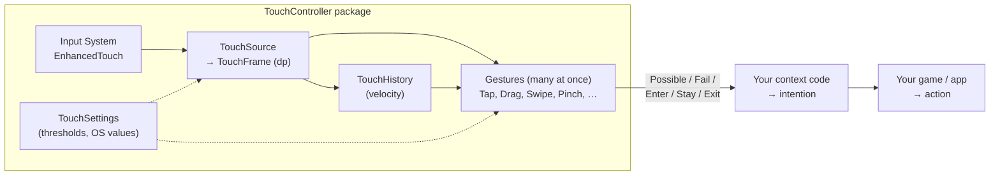

# Using TouchController

TouchController turns raw touches into **gestures** on Android, iOS and Windows touch devices (e.g. Microsoft Surface). It deliberately stops there: it does not decide what the user *meant*. That is the job of your **context** code, which turns gestures into **intentions**, and your game or app code, which carries out the **action**.

> **Status of this document.** Everything described here exists (phases 1–5: settings, input layer, `TouchSystem`, the gesture core and the built-in gestures), except where marked 🚧. The strategy-map example (section 7) is illustrative *user* code: its game types (`CameraRig`, `UnitSelection`, …) are yours, but the TouchController API it uses is real. See `plan.md` in the project root for the design.

---

## 1. The layers



| Layer | Question it answers | Example |
|---|---|---|
| **Gesture** (this package) | *What did the fingers do?* | "A Drag entered, then exited with a Swipe of 900 dp/s to the left." |
| **Intention** (your context code) | *What did the user mean, given what's on screen?* | "The drag started on the map, not a unit, so: pan the camera, then fling it." |
| **Action** (your game) | *What happens?* | Camera moves with inertia. |

The important consequence: **one input often produces several gestures at once**, and that is correct. A quick drag that ends fast is both a *Drag* and a *Swipe*. A tap is also the first half of a possible *DoubleTap*. The package reports all of them, and your context code chooses.

---

## 2. Units and coordinates ✅

- **Distances are in dp**, the platform's density-independent unit: Android dp (1/160 inch), iOS points (1/163 inch), Windows effective pixels (1/96 inch at 100% scaling). A threshold of 8 dp is about the same physical size on any device.
- **Times are in milliseconds** in settings, and **seconds** for timestamps (the Input System clock, `InputState.currentTime`).
- **Speeds are in dp per second.**
- **Positions are screen space, origin bottom-left**, as in Unity's `Screen` and `Camera.ScreenPointToRay`. Convert dp to pixels before raycasting:

```csharp
Vector2 px = frame.DpToPx(touch.positionDp);
Ray ray = Camera.main.ScreenPointToRay(px);
```

---

## 3. Starting and stopping: `TouchSystem` ✅

Everything in the package is owned by one object, **`TouchSystem`**. It is a plain C# class, not a singleton and not a MonoBehaviour, with **one start-up point and one shut-down point**:

| Call | What happens |
|---|---|
| `new TouchSystem(options)` | Stores the configuration. **Nothing starts.** |
| `Startup()` | Resolves the settings (platform, screen density, OS values) and enables touch input. Throws if already running. If anything fails, everything acquired so far is released again. |
| `Update()` | Captures this frame's touches into `Frame` and updates `History` (and, from phase 4, runs the gestures). **You** call it, so you decide where it runs relative to your other systems. |
| `Refresh()` | Re-reads OS values and screen density, e.g. when the app regains focus. |
| `Shutdown()` / `Dispose()` | Releases everything: disables touch input and destroys the runtime settings copy. Safe to call more than once, or before `Startup`. The system can be started again afterwards. |

There is **no global state** in the package. You can run two systems side by side, e.g. one per test. Code that needs touch input receives the `TouchSystem` it should use.

> Unity's Input System `EnhancedTouch` (and the Editor's `TouchSimulation`) are global by Unity's design. `TouchSystem` enables them in `Startup` and releases them in `Shutdown`, using EnhancedTouch's reference count, so it never switches them off under other code that is using them.

### A bootstrap MonoBehaviour

One MonoBehaviour owns the system and hands it to the code that uses it. Disabling the GameObject shuts everything down cleanly, and enabling it starts everything again.

```csharp
using Threads.TouchController;
using UnityEngine;

public class AppBootstrap : MonoBehaviour
{
    [Tooltip("Optional. Leave empty to use the platform's shipped default.")]
    [SerializeField] private TouchSettings touchSettings;

    private TouchSystem _touch;
    private TouchTrails _trails;          // example consumer (section 5)

    private void Awake()
    {
        _touch = new TouchSystem(new TouchSystemOptions { Settings = touchSettings });
    }

    private void OnEnable()
    {
        _touch.Startup();                 // the single start-up point
        _trails = new TouchTrails(_touch); // consumers get the system they should use
    }

    private void Update()
    {
        _touch.Update();                  // first, so everything after it sees this frame's touches
        _trails.Tick();
    }

    private void OnApplicationFocus(bool hasFocus)
    {
        // The user may have changed an accessibility setting while the app was in the background.
        if (hasFocus && _touch.IsRunning)
            _touch.Refresh();
    }

    private void OnDisable()
    {
        _trails = null;
        _touch.Shutdown();                // the single shut-down point
    }
}
```

`TouchSystemOptions` fields are all optional:

| Option | Default when not set |
|---|---|
| `Settings` | The shipped asset for the platform |
| `Platform` | `Host.Platform` (the running platform, or the active build target in the Editor) |
| `OsProvider` | The OS reader for the platform (Android, Windows; none on iOS yet) |
| `Input` | A `TouchSource` reading the Input System |
| `Host` | `UnityTouchHost`: reads `Application`, `Screen` and the Input System clock |
| `SimulateTouchInEditor` | `true`: mouse input becomes touches in the Editor |

`Host`, `Input` and `OsProvider` are interfaces (`ITouchHost`, `ITouchInput`, `IOsTouchConfigProvider`), so tests can replace Unity entirely.

### If you'd rather not pass the reference around

Passing the `TouchSystem` explicitly is the recommended approach. If you want global access, add it **in your own code**, so that you own its lifetime. For example:

```csharp
// Your own holder: you decide when it is set and cleared.
public static class Services
{
    public static TouchSystem Touch { get; set; }
}
// In AppBootstrap.OnEnable:  _touch.Startup(); Services.Touch = _touch;
// In AppBootstrap.OnDisable: Services.Touch = null; _touch.Shutdown();
```

Or register it with a dependency-injection container such as **VContainer**, which then owns the lifetime (sketch, not tested):

```csharp
// In your LifetimeScope.Configure(IContainerBuilder builder):
builder.Register(_ => new TouchSystem(new TouchSystemOptions { Settings = touchSettings }), Lifetime.Singleton);
builder.RegisterEntryPoint<TouchSystemRunner>(); // your class: IStartable.Start -> Startup,
                                                 // ITickable.Tick -> Update, IDisposable.Dispose -> Shutdown
```

---

## 4. Settings ✅

All thresholds live in one ScriptableObject, `TouchSettings`. The package ships one per platform (`TouchSettings_Android`, `_iOS`, `_Windows`). Each asset's **Notes** field says where its values come from and which are still guesses.

At runtime the asset is never used directly. `TouchSystem.Startup` **resolves** it: copies it, works out the screen density, and (if `Policy.useOsValues` is on) replaces values with the operating system's own. On Android these include the user's accessibility settings, such as a longer "Touch & hold delay". The result is `TouchSystem.Environment`:

```csharp
// touch is a running TouchSystem.
TouchEnvironment env = touch.Environment;
TouchSettingsData data = touch.Settings.Data;   // the runtime copy

Debug.Log($"Platform {env.Platform}, {env.Dpi} dpi ({env.DensitySource}), {env.PixelsPerDp} px per dp");
Debug.Log($"Long press after {data.LongPress.longPressTimeoutMs} ms (from {env.GetSource(SettingKeys.LongPressTimeout)})");
Debug.Log($"Touch slop is {env.DpToPx(data.Motion.touchSlopDp)} px on this screen");
```

Things to know:

- **Don't edit the shipped assets.** Make your own with *Create → Threads → TouchController → Touch Settings*, copy values across, and pass it as `TouchSystemOptions.Settings`.
- **Refresh resets runtime edits.** `Refresh` restores the asset's values and then applies the OS values again. Change the asset, not the runtime copy, if you want a change to stick.
- **Sections are never replaced**, only their values. Code holding `data.Fling` or `data.Motion` always sees current values, even after a refresh.
- **Saving to JSON.** The package doesn't depend on a JSON library, but `TouchSettingsData` is designed for one. With Newtonsoft in your own project:

  ```csharp
  string json = JsonConvert.SerializeObject(touch.Settings.Data, Formatting.Indented);
  JsonConvert.PopulateObject(json, touch.Settings.Data); // load into the existing sections
  ```

  `JsonUtility.ToJson` / `FromJsonOverwrite` also work. Note: the two produce different key casing (`"Motion"` vs `"motion"`), so don't mix them for the same file.

---

## 5. Reading touches directly ✅

You can use the touches without any gestures, e.g. for a finger-painting tool or a debug overlay. The consumer is a plain class that is **given** the system. It doesn't create or own anything (see the bootstrap in section 3):

```csharp
using Threads.TouchController;
using UnityEngine;

public sealed class TouchTrails
{
    private readonly TouchSystem _touch;

    public TouchTrails(TouchSystem touch) => _touch = touch;

    /// <summary>Call after TouchSystem.Update each frame.</summary>
    public void Tick()
    {
        foreach (var touch in _touch.Frame.Touches)
        {
            if (touch.phase != TouchPointPhase.Ended) continue;
            Vector2 velocity = _touch.History.GetVelocityDps(touch.touchId);
            Debug.Log($"Touch {touch.touchId} lifted at {velocity.magnitude:F0} dp/s");
        }
    }
}
```

Things to know:

- **Every contact appears in every frame** from `Began` to `Ended` or `Canceled`. It is `Stationary` in frames where it didn't move.
- **`Canceled` means the OS took the touch**, e.g. Android's back gesture or the iOS home indicator. Treat it as "abandon", not "release".
- **`touchId` is unique for the whole session.** It is never reused, even when the OS reuses its own IDs.
- **The frame is reused.** `TouchSystem.Update` refills the same `TouchFrame` every frame, so copy anything you want to keep.
- **Release velocity:** read `GetVelocityDps` in the frame where the touch is `Ended`. The history is dropped on the next update. A finger that pauses before lifting has a velocity near zero, as on Android.

### Unity UI and other Unity APIs

TouchController doesn't replace Unity's UI or EventSystem: use them for anything UI-related. Each `TouchPoint` carries the Input System's own IDs for this:

| Field | Use it for |
|---|---|
| `touchId` | **Tracking** a contact in TouchController (unique for the session). |
| `inputTouchId` | **Unity APIs** that take a touch ID: the Input System's `TouchControl.touchId`. Only unique per device, and may be reused. |
| `inputDeviceId` | The touchscreen it came from: `InputSystem.GetDeviceById(inputDeviceId)`. |

Both Input System fields are 0 for scripted or recorded input.

```csharp
// Is this finger over UI? (Requires InputSystemUIInputModule on the EventSystem.)
bool overUi = EventSystem.current.IsPointerOverGameObject(touch.inputTouchId);

// Or by position, which is reliable on the very frame the touch begins:
var hits = new List<RaycastResult>();
EventSystem.current.RaycastAll(new PointerEventData(EventSystem.current) { position = frame.DpToPx(touch.positionDp) }, hits);
bool overUiNow = hits.Count > 0;
```

`IsPointerOverGameObject` reports the UI module's state from its **last** update. On the frame a touch begins, the module may not have processed it yet, so it can return `false`. For a decision made at touch-down, use the position-based `RaycastAll`. For later frames, `IsPointerOverGameObject` is fine.

---

## 6. Gestures ✅

### Setting up

Nothing extra: `TouchSystem.Update` also runs every gesture in the settings asset's **Lineup**, in order. Each gesture is its own ScriptableObject asset (`Tap.asset`, `Drag.asset`, …). Each lineup entry has an **enabled** tick box for the gesture's starting state. The shipped platform settings contain every built-in gesture, with the platform's double tap (`AndroidDoubleTap`, `IosDoubleTap` or `WindowsDoubleTap`). Every other gesture asset is shared between the platforms.

### Built-in gestures

All thresholds come from the settings (section 4), so they follow the platform and the user's accessibility settings. "Slop" is `Motion.touchSlopDp`.

| Gesture (`Get<…>()`) | Fingers | Type | Enter | Exit / Fail | Reports |
|---|---|---|---|---|---|
| `PressGesture` | 1 per instance | continuous | on touch-down (same update as Possible) | Exit on lift. Release *is* Press's Exit. | position |
| `TapGesture` | 1 per instance | discrete | Enter + Exit on lift | Fail: `Moved` (beyond slop), `Held` (past long-press time, while still down) | `TapCount` = 1 |
| `DoubleTapGesture` (platform variant) | 1 | Android: continuous · iOS/Windows: discrete | Android: 2nd finger **down**; stays active while held (double-tap-then-drag). iOS/Windows: 2nd finger **up** | Fail: `Moved`, `Held`, `Timeout` (no 2nd tap in time; the "single tap confirmed" signal), `TooFast`, `TooFar`, `FingerCount` | `TapCount` = 2 |
| `LongPressGesture` | 1 per instance | continuous | held for the long-press time within slop (no input needed) | Exit on lift. Fail: `Moved`, `Released`. May move after Enter. | position |
| `DragGesture` | 1 per instance | continuous | moved beyond slop | Exit on lift. Fail: `Released` (never moved) | `DeltaDp`, velocity |
| `SwipeGesture` | 1 per instance | discrete | Enter + Exit on a fast lift along an axis | Fail: `Released` (didn't move), `TooSlow` (incl. pausing before the lift), `Direction` (> tolerance from an axis) | `Direction` (±x / ±y), release velocity (clamped) |
| `PinchGesture` | all | continuous | span ≥ min span **and** changed by > 2 × slop | Exit when < 2 fingers or span < min. Fail: `FingerCount` | `Scale` (since Possible), `ScaleDelta` |
| `RotateGesture` | all | continuous | turned ≥ min rotation | Exit when < 2 fingers. Fail: `FingerCount` | `AngleDeg` (CCW +, unlimited), `AngleDeltaDeg` |
| `TwoFingerPanGesture` | all | continuous | centroid moved beyond slop | Exit when < 2 fingers. Fail: `FingerCount` | `DeltaDp` of the centroid |
| `TwoFingerTapGesture` | 2 | discrete | Enter + Exit when both have lifted | Fail: `Timeout` (2nd finger later than the window), `Released`, `Moved`, `Held`, `FingerCount` | — |
| `EdgeSwipeGesture` | 1 per instance | continuous | starts in an edge strip, moves beyond slop within 45° of inwards | Exit on lift. Fail: `Direction`, `Released`. Touches outside the strips are never Possible. | `Edge`, inward `Direction` |

Notes:
- **Several gestures overlap.** For example, a quick drag that ends fast gives a Drag Exit *and* a Swipe in the same update. Pinch, Rotate and TwoFingerPan can all be active at once. That's intended: the context code chooses.
- **No jumps when fingers join or leave.** For Pinch, Rotate and TwoFingerPan, the scale, angle and position continue from their current values.
- **Edge swipe settings:** `EdgeSwipeGesture` has per-edge tick boxes (`left`, `right`, `bottom`, `top`) on its asset.
- **Per-gesture notes:** every gesture asset has a **Notes** field. `WindowsDoubleTap`'s notes record the Q11 guess (recognised on the second finger *up*), which needs checking on a Surface.

At `Startup` the system makes a **runtime copy** of every gesture in the lineup. The assets are never run or changed. Always subscribe to the running copy, which you get from the system:

| Call | What it does |
|---|---|
| `touch.Get<T>()` | The first running gesture of type `T` (a class, base class or interface). Throws if there is none. |
| `touch.TryGet<T>(out var g)` | The same, without throwing. |
| `touch.Gestures` | All running gestures, in update order. |
| `touch.Add(asset, enabled)` | Starts a copy of a gesture asset at runtime and returns the running copy. |
| `touch.Remove(gesture)` | Disables it (sending `OnDisabled`) and destroys it. Safe inside an event handler. |

Each gesture also tells you its state without you tracking events: `IsActive` (any instance between Enter and Exit), `IsPossible`, `Instances`, `Enabled` and `RunState`.

### Event data

Every event carries a `GestureEventData`:

| Field | Meaning |
|---|---|
| `Type`, `Reason` | The event, and why it failed or exited (`None` otherwise). |
| `InstanceId` | Unique within the TouchSystem, across all gestures. |
| `FingerId`, `FingerIds`, `FingerCount` | The instance's primary finger (`TouchPoint.touchId`) and all its fingers. |
| `InputTouchId` | The primary finger's Input System ID, for Unity APIs (section 5). |
| `PositionDp`, `PositionPx` | Position (centroid for several fingers). |
| `DeltaDp` | Movement since **this instance's previous event**. |
| `VelocityDps` | From the touch history. |
| `Scale`, `ScaleDelta`, `AngleDeg`, `AngleDeltaDeg` | Pinch and rotate. The deltas are since the previous event (`ScaleDelta` is a factor). |
| `TapCount`, `Direction`, `Edge` | Multi-tap, swipe and edge gestures. |
| `Time`, `StartTime` | When this event happened, and when the instance became Possible. |
| `Instance` | The live instance (its values keep changing after the event). |

### The life of a gesture

Every gesture follows the same state machine, and you get one event per transition:

| Event | Meaning | Use it for |
|---|---|---|
| `Possible` | This input *might* become the gesture. | Early feedback (highlight, haptic), starting to prepare. |
| `Fail` | It didn't happen, with a reason (`Moved`, `Timeout`, `TooFar`, …). | Undoing early feedback. `DoubleTap` `Fail(Timeout)` means "it was just a single tap". |
| `Enter` | The gesture was recognised. | Starting an action. |
| `Stay` | Still active (every frame). | Continuous actions: dragging, zooming. |
| `Exit` | Over: `Completed` or `Cancelled`. | Finishing or undoing an action. |
| `OnDisabled` / `OnEnabled` | The gesture was switched off or on. | On `OnDisabled`, drop every instance of that gesture you were tracking. **No `Exit` is sent.** |

Guarantees: `Possible` always comes first; each instance ends with exactly one of `Fail` or `Exit` (unless the gesture is disabled, in which case `OnDisabled` replaces them). Discrete gestures (Tap, Swipe) send `Enter` and `Exit` in the same frame.

One-finger gestures run **one instance per finger**, so two thumbs can drag independently. Each event carries an **instance ID** to tell instances apart.

### Subscribing

```csharp
// touch is the running TouchSystem you were given.
touch.Get<DragGesture>().Enter += e => Debug.Log($"Drag {e.InstanceId} started at {e.PositionDp}");
touch.Get<DragGesture>().Stay  += e => Debug.Log($"Drag moved by {e.DeltaDp}");
touch.Get<DragGesture>().Exit  += e => Debug.Log($"Drag ended: {e.Reason}");
```

Platform variants of a gesture (e.g. the three double taps) share a base class, so you subscribe once with `Get<DoubleTapGesture>()` whatever the platform.

Events are sent from inside `TouchSystem.Update`. An exception in your handler is logged, and recognition carries on.

### Enabling and disabling ✅

```csharp
touch.Get<RotateGesture>().Enabled = false;   // OnDisabled fires; nothing else from Rotate
touch.Get<RotateGesture>().Enabled = true;    // OnEnabled fires; Rotate starts again with a new touch sequence
```

A disabled gesture is silent: it discards its instances **without** `Fail` or `Exit`. When re-enabled it is reset. If any finger is on the screen at that moment, it waits until the screen is completely clear (`RunState == WaitingForClear`), so it never starts halfway through a touch. If the screen is already clear, it runs at once. Disabling from inside an event handler takes effect immediately: nothing more is sent that frame.

Gestures also ignore any touch that was already down when the system started. They only react to touches they saw begin.

### Writing your own gesture ✅

A gesture is a ScriptableObject derived from `GestureBase<TInstance>`. You only write `OnFrame`, which decides when instances begin, fail, enter and exit. The base class does the rest:

- **Eligible touches only:** it offers only touches that began while the gesture was running (`EligibleTouches`).
- **Position and velocity:** each instance tracks the centroid and mean velocity of its fingers.
- **OS cancellation:** cancelled or vanished touches fail or exit the instance with `Cancelled`.
- **Stay:** it sends `Stay` every frame for active instances.
- **The rules:** it **enforces** the event rules. An illegal transition (e.g. Exit from Possible) throws.

```csharp
using Threads.TouchController;
using UnityEngine;

// Long-press-like: one instance per finger. Enter after the platform's long-press time, Exit on release.
[CreateAssetMenu(menuName = "My Game/Gestures/Hold")]
public sealed class HoldGesture : GestureBase<GestureInstance>
{
    protected override void OnFrame(TouchFrame frame)
    {
        foreach (var touch in EligibleTouches)
            if (touch.phase == TouchPointPhase.Began)
                BeginPossible(touch.touchId);                       // sends Possible

        foreach (var instance in LiveInstances())
        {
            frame.TryGet(instance.PrimaryFingerId, out var touch);
            if (instance.State == GestureState.Possible)
            {
                if ((touch.positionDp - instance.StartPositionDp).magnitude > Settings.Motion.touchSlopDp)
                    FailInstance(instance, GestureReason.Moved);
                else if (touch.HasEnded)
                    FailInstance(instance, GestureReason.Released);
                else if (HasElapsed(instance.StartTime, Settings.LongPress.longPressTimeoutMs))
                    EnterInstance(instance);                        // time-driven: no input needed
            }
            else if (touch.HasEnded)
            {
                ExitInstance(instance);                             // Exit(Completed)
            }
        }
    }
}
```

| Helper | Use |
|---|---|
| `BeginPossible(fingerId)` / `BeginPossible(fingerIds)` | New instance (one finger, or several such as "all fingers"). Sends Possible. |
| `FailInstance`, `EnterInstance`, `ExitInstance`, `RecogniseInstance` | Transitions. `RecogniseInstance` is Enter and Exit together, for discrete gestures. |
| `AddFinger`, `RemoveFinger` | Fingers joining or leaving a multi-finger instance. |
| `SetScale`, `SetAngle`, `SetTapCount`, `SetDirection`, `SetEdge`, `SetPosition`, `SetVelocity` | Values reported in the event data. **Set them before the transition that reports them.** |
| `Settings`, `History`, `Time`, `PixelsPerDp` | The live thresholds, touch history and current time. |
| `HasElapsed(since, ms)` | **Use for every time threshold.** It tolerates floating-point rounding, so a threshold reached exactly by whole frames counts. |
| `LiveInstances()` | Instances that haven't finished, safe to transition while iterating. |
| `OnInitialise`, `OnDiscard` | Set up, and reset gesture-level state when disabled or enabled. |

Per-instance data goes in your own instance class, e.g. `class DoubleTapInstance : GestureInstance { public double FirstUpTime; }` with `GestureBase<DoubleTapInstance>`. Gesture-specific *settings* (e.g. "needs 2 fingers") are serialised fields on the gesture asset. Shared thresholds always come from `Settings`, never from fields of your own, so each value has one home.

**Blocking is your job.** The package doesn't know about UI. If a touch starts on a button, your context code should ignore the gestures for that finger. See the example below.

---

## 7. Example: from gestures to intentions

A small strategy game on a phone. The player looks at a map with units on it. These are the **intentions** we want:

| Intention | What the player does |
|---|---|
| **Select unit** | Tap a unit. |
| **Move unit** | With a unit selected, tap the ground. |
| **Focus camera** | Double tap anywhere: centre the camera there. |
| **Open unit menu** | Long press a unit. |
| **Drag unit to destination** | Long press a unit, then drag it. |
| **Pan camera** (with fling) | Drag the map; flick to keep it gliding. |
| **Zoom camera** | Pinch. |
| *(nothing)* | Any touch that starts on the HUD (buttons, minimap). |

### The context

The context code needs to know:

1. **What is under the finger where it touched down:** a unit, the ground, or UI. Decided once per finger at `Possible` and remembered, because the finger moves.
2. **Game state:** is a unit selected?
3. **Which gestures are active together.** For example, "Drag entered while LongPress is active" means *drag the unit*, but "Drag entered with no LongPress" means *pan*.

### The decisions

| Gesture events | Context | Intention |
|---|---|---|
| `Tap` Enter | Finger started on a unit | **Select unit**, immediately. It's harmless if this turns out to be the first half of a double tap. |
| `Tap` Enter | On ground, a unit is selected | Wait. A double tap might follow, and moving the unit then focusing the camera would be wrong. |
| `DoubleTap` Fail(Timeout) after a ground tap | A unit is selected | **Move unit** to the tapped point. The ~300 ms wait is the price of also supporting double tap on the ground. |
| `DoubleTap` Enter | Anywhere | **Focus camera.** Cancel any pending "Move unit". |
| `LongPress` Enter | Finger started on a unit | **Open unit menu.** |
| `Drag` Enter while `LongPress` is active on the same finger | Finger started on a unit | Close the menu. **Drag unit to destination.** |
| `Drag` Enter, no LongPress | Finger started on ground | **Pan camera** (follow `Stay` deltas). |
| `Drag` Exit + `Swipe` Enter, same finger, same frame | Was panning | **Fling camera** with the swipe's velocity. |
| `Pinch` Enter / Stay | Any | **Zoom camera.** Stop panning with the individual fingers while pinching. |
| Any `Possible` | Finger started on UI | Ignore everything from this finger. |
| `Rotate` | — | Not wanted in this game: set `Enabled = false` at start-up. |

Notice the two different tap strategies. **Select unit** acts at once because selecting is harmless if a double tap follows. **Move unit** waits for the double tap to fail because moving is not harmless. The package can't make that choice: it depends on what the actions do.

### Sketch

```csharp
// Illustrative: this class is YOUR code, not part of the package. CameraRig, UnitSelection, Unit and
// UnitMenu stand for your game's own types; everything from Threads.TouchController is real.
// Like the package, it has one start-up and one shut-down point, and is given what it needs.
using System.Collections.Generic;
using Threads.TouchController;
using UnityEngine;
using UnityEngine.EventSystems;

public sealed class StrategyMapIntentions
{
    private readonly TouchSystem touch;
    private readonly CameraRig cameraRig;
    private readonly UnitSelection selection;

    private enum Target { Ground, Unit, Ui }

    // Context remembered per finger, decided when the finger first touched down.
    private readonly Dictionary<int, (Target target, Unit unit, Vector3 worldPoint)> _fingers = new();
    private readonly HashSet<int> _longPressedFingers = new();
    private Vector3? _pendingMove;   // waiting to see if a double tap follows

    public StrategyMapIntentions(TouchSystem touch, CameraRig cameraRig, UnitSelection selection)
    {
        this.touch = touch;
        this.cameraRig = cameraRig;
        this.selection = selection;
    }

    /// <summary>Call after touch.Startup().</summary>
    public void Startup()
    {
        touch.Get<RotateGesture>().Enabled = false;

        touch.Get<PressGesture>().Possible  += OnFingerDown;
        touch.Get<PressGesture>().Exit      += OnFingerUp;
        touch.Get<TapGesture>().Enter       += OnTap;
        touch.Get<DoubleTapGesture>().Enter += OnDoubleTap;
        touch.Get<DoubleTapGesture>().Fail  += OnDoubleTapFailed;
        touch.Get<LongPressGesture>().Enter += OnLongPress;
        touch.Get<DragGesture>().Enter      += OnDragStart;
        touch.Get<DragGesture>().Stay       += OnDragMove;
        touch.Get<DragGesture>().Exit       += OnDragEnd;
        touch.Get<SwipeGesture>().Enter     += OnSwipe;
        touch.Get<PinchGesture>().Stay      += OnPinch;
    }

    /// <summary>Call before touch.Shutdown(). Unsubscribes everything Startup subscribed.</summary>
    public void Shutdown()
    {
        touch.Get<PressGesture>().Possible  -= OnFingerDown;
        touch.Get<PressGesture>().Exit      -= OnFingerUp;
        touch.Get<TapGesture>().Enter       -= OnTap;
        touch.Get<DoubleTapGesture>().Enter -= OnDoubleTap;
        touch.Get<DoubleTapGesture>().Fail  -= OnDoubleTapFailed;
        touch.Get<LongPressGesture>().Enter -= OnLongPress;
        touch.Get<DragGesture>().Enter      -= OnDragStart;
        touch.Get<DragGesture>().Stay       -= OnDragMove;
        touch.Get<DragGesture>().Exit       -= OnDragEnd;
        touch.Get<SwipeGesture>().Enter     -= OnSwipe;
        touch.Get<PinchGesture>().Stay      -= OnPinch;
        _fingers.Clear();
        _longPressedFingers.Clear();
        _pendingMove = null;
    }

    private void OnFingerDown(GestureEventData e) => _fingers[e.FingerId] = Classify(e);

    private void OnFingerUp(GestureEventData e)
    {
        _fingers.Remove(e.FingerId);
        _longPressedFingers.Remove(e.FingerId);
    }

    private void OnPinch(GestureEventData e) => cameraRig.Zoom(e.ScaleDelta);

    private readonly List<RaycastResult> _uiHits = new();

    private (Target, Unit, Vector3) Classify(GestureEventData e)
    {
        // Unity UI decides whether the finger is on the HUD (see section 5, "Unity UI").
        // At touch-down, ask the EventSystem by position: it is always current.
        _uiHits.Clear();
        EventSystem.current.RaycastAll(new PointerEventData(EventSystem.current) { position = e.PositionPx }, _uiHits);
        if (_uiHits.Count > 0) return (Target.Ui, null, default);

        var ray = Camera.main.ScreenPointToRay(e.PositionPx);
        if (Physics.Raycast(ray, out var hit))
            return hit.collider.TryGetComponent(out Unit unit)
                ? (Target.Unit, unit, hit.point)
                : (Target.Ground, null, hit.point);
        return (Target.Ground, null, default);
    }

    private bool Ignored(GestureEventData e, out (Target target, Unit unit, Vector3 worldPoint) ctx) =>
        !_fingers.TryGetValue(e.FingerId, out ctx) || ctx.target == Target.Ui;

    private void OnTap(GestureEventData e)
    {
        if (Ignored(e, out var ctx)) return;
        if (ctx.target == Target.Unit)
            selection.Select(ctx.unit);                  // harmless even if a double tap follows
        else if (selection.HasSelection)
            _pendingMove = ctx.worldPoint;               // not harmless: wait for the double tap to fail
    }

    private void OnDoubleTapFailed(GestureEventData e)
    {
        if (e.Reason != GestureReason.Timeout || _pendingMove == null) return;
        selection.MoveTo(_pendingMove.Value);            // it really was a single tap
        _pendingMove = null;
    }

    private void OnDoubleTap(GestureEventData e)
    {
        _pendingMove = null;                             // it was a double tap after all
        cameraRig.FocusOn(e.PositionPx);
    }

    private void OnLongPress(GestureEventData e)
    {
        if (Ignored(e, out var ctx) || ctx.target != Target.Unit) return;
        _longPressedFingers.Add(e.FingerId);
        UnitMenu.Open(ctx.unit);
    }

    private void OnDragStart(GestureEventData e)
    {
        if (Ignored(e, out var ctx)) return;
        if (_longPressedFingers.Contains(e.FingerId))   // LongPress active + Drag entered
        {
            UnitMenu.Close();
            selection.BeginDragTo(ctx.unit);
        }
        else if (ctx.target == Target.Ground)
        {
            cameraRig.BeginPan();
        }
    }

    private void OnDragMove(GestureEventData e)
    {
        if (Ignored(e, out _) || touch.Get<PinchGesture>().IsActive) return;   // pinch takes over
        if (_longPressedFingers.Contains(e.FingerId)) selection.UpdateDrag(e.PositionPx);
        else cameraRig.Pan(e.DeltaDp);
    }

    private void OnDragEnd(GestureEventData e)
    {
        if (_longPressedFingers.Contains(e.FingerId)) selection.EndDrag(e.Reason == GestureReason.Completed);
        else cameraRig.EndPan();
    }

    private void OnSwipe(GestureEventData e)
    {
        // Arrives in the same frame as the Drag's Exit: a flick at the end of a pan.
        if (Ignored(e, out var ctx) || ctx.target != Target.Ground || _longPressedFingers.Contains(e.FingerId)) return;
        cameraRig.Fling(e.VelocityDps);
    }
}
```

Wired into the bootstrap from section 3:

```csharp
// AppBootstrap.OnEnable
_touch.Startup();
_intentions = new StrategyMapIntentions(_touch, cameraRig, selection);
_intentions.Startup();

// AppBootstrap.OnDisable: shut down in reverse order
_intentions.Shutdown();
_touch.Shutdown();
```

### Walking through two inputs

**A. The player flicks the map** (finger down on the ground, moves 20 dp, lifts fast):

| Time | Gesture events | Context code |
|---|---|---|
| Finger down | `Press` Possible + Enter; `Tap`, `DoubleTap`, `LongPress`, `Drag`, `Swipe` Possible | Classifies the finger: **Ground**. |
| Moved past 8 dp | `Tap`, `DoubleTap`, `LongPress` **Fail(Moved)**; `Drag` **Enter** | Not long-pressed, on ground: **begin pan**. |
| Moving | `Drag` Stay | **Pan** by each delta. |
| Lifts fast | `Drag` **Exit(Completed)**; `Swipe` **Enter + Exit**; `Press` Exit | End pan, then **fling** with the swipe velocity. |

**B. The player taps the ground with a unit selected:**

| Time | Gesture events | Context code |
|---|---|---|
| Finger down | `Tap`, `DoubleTap`, `LongPress`, `Drag`, `Swipe` Possible | **Ground**. |
| Lifts quickly | `Tap` **Enter + Exit**; `Drag`, `Swipe`, `LongPress` Fail | Unit selected, on ground: remember a **pending move**. Don't act yet. |
| 300 ms, no second tap | `DoubleTap` **Fail(Timeout)** | It was a single tap: **move the unit**. |

If a second tap had arrived in time, `DoubleTap` would have entered instead, and the pending move would have been dropped in favour of **focus camera**.

---

## 8. Testing gestures and context code ✅

Gestures and the input layer only depend on `TouchFrame`s, so they can be tested without a device or the Input System. The package's test tools are in the **`Threads.TouchController.Testing`** assembly. Add it to your test assembly definition's references, next to `Threads.TouchController`. It is only compiled when tests are (`UNITY_INCLUDE_TESTS`).

| Tool | What it does |
|---|---|
| `ScriptedTouchInput` | Produces `TouchFrame`s with exact timing: `Down`, `Move`, `Up`, `Cancel`, `Step`, `Hold`, `Drag`. |
| `GestureHarness<T>` | Runs one gesture on scripted input, with a private copy of a platform's thresholds (`Settings`). |
| `TouchSystemHarness` | Runs a whole `TouchSystem` (a platform's full lineup) on scripted input, with an event log per gesture (`Log<T>()`). |
| `GestureEventLog` | Records a gesture's events as text (`"Possible#1"`, `"Exit(Completed)#1"`, `"OnDisabled"`, …) and lists any broken event rules in `Violations`. |

```csharp
using NUnit.Framework;
using Threads.TouchController.Testing;
using UnityEngine;

public class HoldGestureTests
{
    [Test]
    public void HeldLongEnough_EntersThenExits()
    {
        using var h = new GestureHarness<HoldGesture>();      // Android thresholds by default
        h.Input.Down(1, new Vector2(100, 100));
        h.Input.Step();
        h.Input.Hold(450);                                     // past the 400 ms long press
        h.Input.Up(1);
        h.Input.Step();

        CollectionAssert.AreEqual(new[] { "Possible#1", "Enter#1", "Exit(Completed)#1" }, h.Log.WithoutStays());
        Assert.IsEmpty(h.Log.Violations);
    }
}
```

To test context code against **all** the gestures at once, use `TouchSystemHarness`. It runs a real `TouchSystem` with a platform's full lineup on scripted input. Every `Step` runs one `TouchSystem.Update`:

```csharp
using var h = new TouchSystemHarness(TouchPlatform.Android);
var intentions = new StrategyMapIntentions(h.System, cameraRig, selection);   // your context code
intentions.Startup();

var drag = h.Log<DragGesture>();
var swipe = h.Log<SwipeGesture>();
h.Input.Down(1, new Vector2(200, 400)); h.Input.Step();
h.Input.Drag(1, new Vector2(320, 400), durationMs: 80);   // a quick flick
h.Input.Up(1); h.Input.Step();

Assert.AreEqual(1, swipe.Count(GestureEventType.Enter));   // and assert on what your context code decided
Assert.IsEmpty(h.Violations());
```

`ScriptedTouchInput` also implements `ITouchInput`, so you can plug it into a `TouchSystem` of your own if you need different options.

🚧 Later, **recorded** input will join these tools: real gestures captured on devices, saved as `TouchFrame` sequences and replayed in tests.

---

## 9. Rules of thumb

- **One owner starts and stops the `TouchSystem`; everyone else is given it.** Want global access? Add it in your own code (or a DI container) so you control its lifetime.

- **Expect several gestures at once.** Design intentions around combinations ("Drag while LongPress is active"), not single events.
- **Classify each finger when it touches down** (UI, object, empty space) and remember it. Where the finger *is now* is rarely the right question.
- **Act immediately when it's harmless; wait for `Fail` when it isn't.** `DoubleTap` `Fail(Timeout)` is your "single tap confirmed".
- **Treat `Exit(Cancelled)` and `Canceled` touches as "abandon"**, not "complete". The OS took the touch.
- **Work in dp; convert to pixels only for raycasts and drawing.**
- **Use Unity's own systems for UI** (EventSystem, raycasters), passing `inputTouchId` or the pixel position. TouchController provides the touch data, not a UI layer.
- **Don't hard-code thresholds.** Read them from the settings so they follow the platform and the user's accessibility settings.
